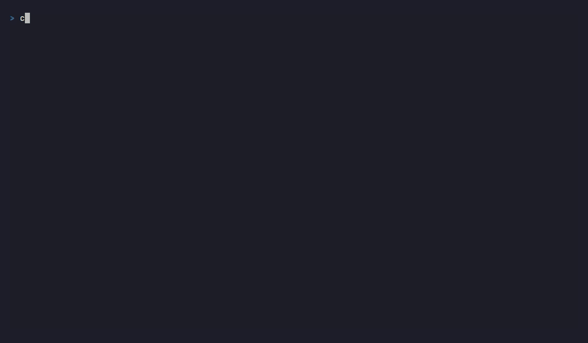
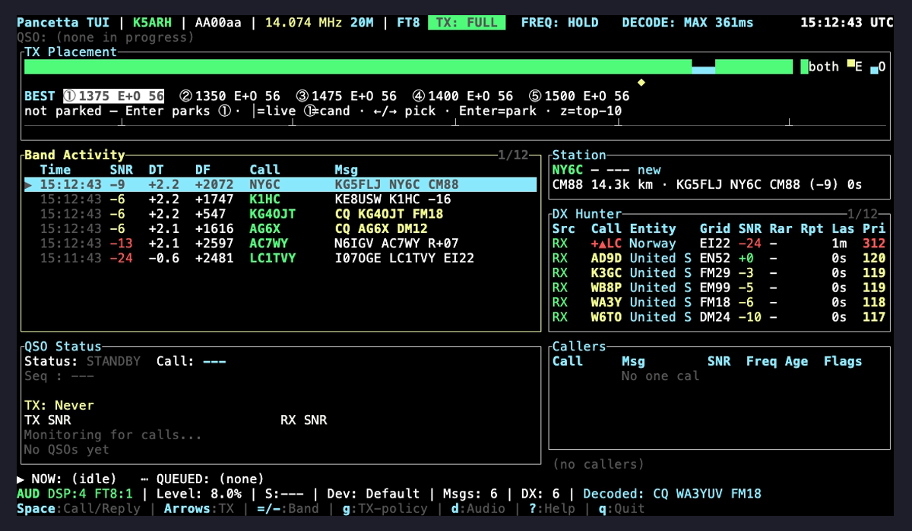
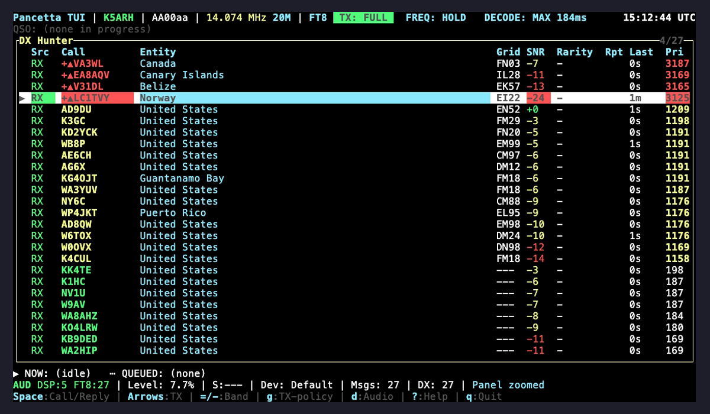
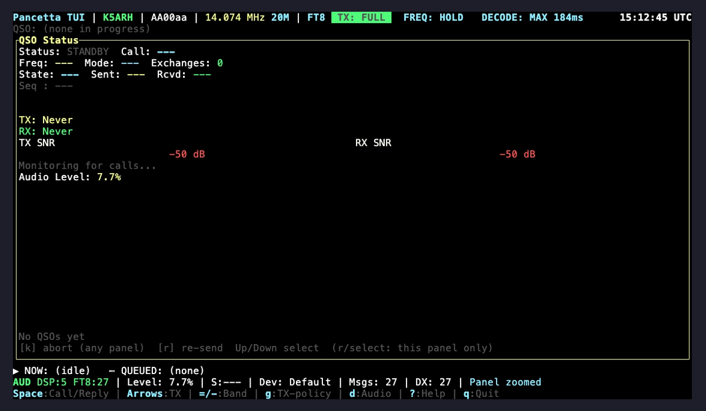
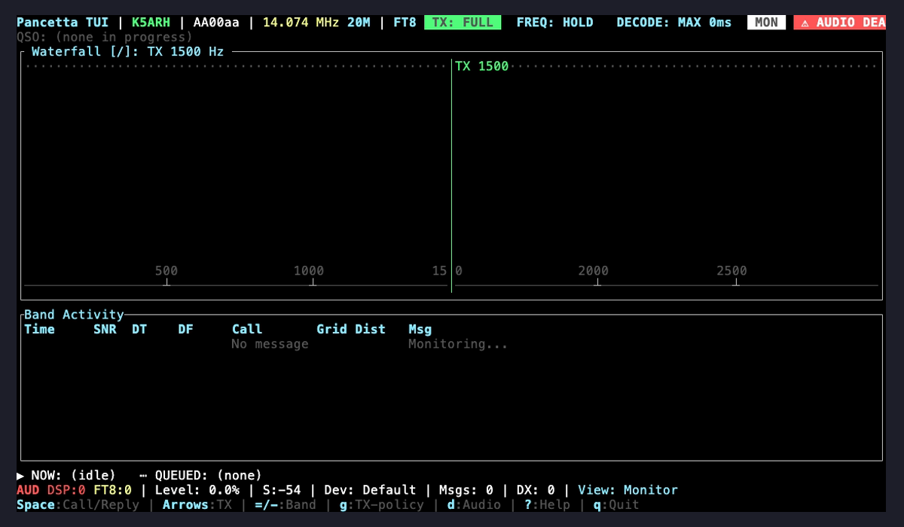
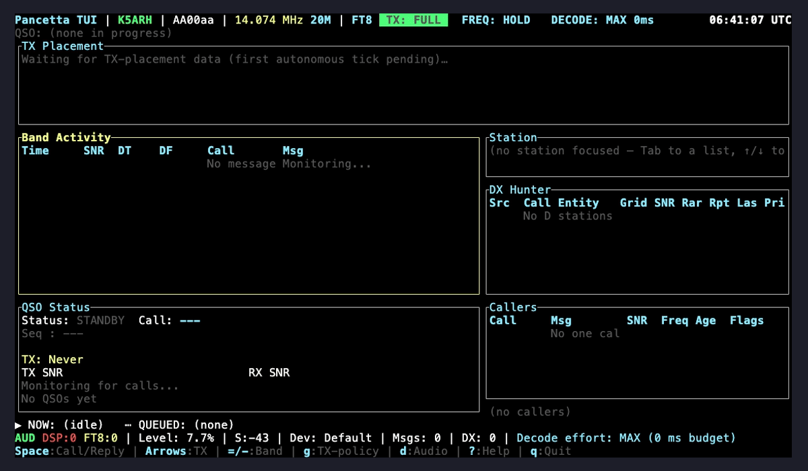

<p align="center">
  
</p>

<h1 align="center">Pancetta</h1>

<p align="center">
  A full FT8 station in one Rust binary — decode, score, work, log.<br>
  Built and operated by <strong>Tony Hagale, W5AU</strong>.
</p>

<p align="center">
  <a href="https://github.com/HagaleTechnologies/pancetta/actions/workflows/ci.yml"></a>
  <a href="#license"></a>
</p>

Pancetta is an FT8 station that lives in your terminal.



*`pancetta --replay` feeding archived WAV captures through the real pipeline:
startup, band monitoring, the TX-placement scorer ranking candidate offsets,
a burst of real FT8 decodes filling Band Activity when the capture reaches
its decodable slot, and a clean self-shutdown when the recording ends. One
recording of one small corpus proves nothing about recall — for measured
decode performance see
[`docs/decoder-comparison.md`](docs/decoder-comparison.md).*

## The pitch

Operating FT8 seriously today means WSJT-X for the modem, a logger for the
log, GridTracker for what's needed, and a cluster client for spots — four
alt-tabbed windows, each with its own idea of what your station is doing.
Pancetta is one binary and one terminal: decode, priority scoring, QSO state
machine, DX cluster, PSKReporter, and logbook upload in a single process that
runs as happily over SSH on a headless box behind the radio as on a desktop.

## Why Pancetta

- **A decoder measured against the real reference.** Against WSJT-X's `jt9` —
  the decoder hams actually run — Pancetta's native decoder alone needs
  **~2.1 dB more SNR** to reach 50% recall on FT8, and **~3.95 dB more on
  FT4, where it caps at 78% recall**, at a false-positive cost of 1 decode
  per 1,000 pure-noise recordings (0.1%). The shipped pipeline adds
  ft8_lib's decodes to the native set: on the same synthetic FT8 corpus it
  reaches 50% recall at about **−19.5 dB**, versus −19.3 dB for the
  native decoder alone (measured on a CI-class x86-64 host; Pi and MiniPC
  unmeasured). In short: competitive, not yet class-leading. (An older
  1,201-file comparison against `ft8_lib` showed +11.6% more decodes, but
  `ft8_lib` is not the bar operators care about.) Full numbers and caveats:
  [`docs/decoder-comparison.md`](docs/decoder-comparison.md).
- **A priority engine, not a list.** Every decoded CQ is scored against
  needed DXCC, needed grid, a portable callsign suffix (`/P`, `/POTA`…) as a
  possible POTA/SOTA hint, rarity, signal, and recent activity —
  so the station you should work is the one at the top.
- **Multi-stream TX.** A smart frequency allocator places N simultaneous FT8
  signals inside one 15-second slot, each on its own audio offset, all on the
  same parity.
- **Headless by design.** `--headless` logs instead of drawing; the decoder
  is an *anytime* algorithm with a per-window budget that self-tunes to the
  host, so slow hardware degrades recall instead of falling over.
- **`pancetta doctor`.** One command checks config, clock vs. NTP, audio
  device and level, decoder, `rigctld`, enabled network services, log disk
  space and microphone permission. It prints the fix for each warning or
  failure. Verdicts are ON-AIR READY (exit 0), DECODE-ONLY (1), NOT
  CONFIGURED (2), and NOT READY (3). `pancetta doctor --json` emits one
  report with per-check status, detail and fix. ON-AIR READY covers these
  prerequisites; doctor does not test PTT or transmit audio.

On-air TX has been validated end-to-end against a Yaesu FTdx10 (clean ALC,
PSKReporter spots across North America and Europe).

<!-- TODO (maintainer): drop a PSKReporter map capture at assets/pskreporter.png
     and reference it here as on-air proof. Requires a real pskreporter.info
     session, so it could not be captured automatically. -->

## What it looks like

Every capture below — and the GIF further down, and the hero GIF above — was
recorded on a development host with `pancetta --replay`, feeding archived
off-air WAV captures through the real pipeline (see [`.tapes/`](.tapes/)).
Real audio, real decodes, real panels — no mockups. The corpus is one short
recording, so treat these as a tour of the interface, not a performance
claim: the QSO panel in particular is shown idle (`STANDBY`, "No QSOs yet"),
because a completed QSO needs a multi-slot two-way handshake that a receive-
only replay of someone else's traffic can't produce.

| | |
|---|---|
|  |  |
| Operate overview: TX placement, band activity, QSO status, callers. | DX Hunter: the priority-scoring table (entity, grid, SNR, rarity, score). |
|  |  |
| QSO status (idle in this replay): state machine, exchanges, TX/RX reports. | Monitor: the waterfall and the TX-frequency marker. |

Decode effort is a live control — press `e` to cycle presets and the status
chip follows:



| Preset | Behavior |
|---|---|
| `Auto` (default) | Budget derived from the auto-probed hardware tier. |
| `Eco` | Floor pass only — fastest, lowest recall. |
| `Standard` | A moderate per-window budget. |
| `Deep` | A generous budget — more passes/candidates, better recall. |
| `Max` | Runs every decode stage, still bounded by the coordinator's per-slot ceiling (2 s on FT8). |

Pin it at startup via `[decoder]` in `pancetta.toml`
([`docs/CONFIG.md`](docs/CONFIG.md)); `e` is the only *live* control. Full
keybinding reference: [`docs/KEYBINDINGS.md`](docs/KEYBINDINGS.md), or press
`?` in the TUI.

## Autonomy with a control operator present

Hands-off operation is opt-in (`[autonomous] enabled = true`) and assumes a
licensed control operator is at the keyboard and can stop it instantly:

- **`Shift+Q` is an emergency stop** — halts TX and switches autonomous off.
  It drops the runtime autonomy gate, and every TX item the engine produced
  for that cycle is discarded before it can be keyed.
- **Autonomous *initiation* requires a present operator.** Calling CQ or
  pouncing needs a console keypress within the last two minutes (FCC §97.221:
  a station with nobody at the control point may respond, not originate).
  Headless or idle, Pancetta drops to respond-only; QSOs already in progress
  still finish. Every autonomous TX item additionally has to clear the active
  `TxPolicy` (e.g. dry-run/listen-only modes).
- **The *remote*-TX arm gate fails closed.** Separate from the above, and
  specific to transmissions originated over the remote-operation protocol:
  a poisoned lock means no transmit, never a permissive fallback, and it ANDs
  under the active TX policy. It governs `TxOrigin::Remote` only — local and
  autonomous TX are gated by the mechanisms above.
- **Drop-stale-TX.** The TX worker re-checks QSO liveness at the last instant
  before PTT, so a frame for a QSO that just ended never goes out.
- **One parity, always.** Concurrent QSOs share a slot parity; Pancetta never
  transmits in sequential windows.

Regulatory notes, including FCC §97.221 automatic-control considerations:
[`docs/fcc-part97-compliance.md`](docs/fcc-part97-compliance.md).

## cqdx.io integration

Pancetta pairs with **[cqdx.io](https://cqdx.io)**, the DX/logbook layer around
the station:

- **Hunting.** The needed-DXCC feed from cqdx.io flows straight into the
  priority scorer, so DX Hunter weighs decoded CQs by what you actually
  still need. Matching uses ADIF DXCC entity IDs, so alternate prefixes share the
  right needed status and US dependencies remain separate. Unknown API IDs
  retain a prefix fallback for compatibility. Needed-grid is wired on
  the Pancetta side but has no live cqdx.io endpoint yet, so it doesn't
  affect rankings today. DX Hunter marks a station needed (`+`) only once
  cqdx.io's needed list has loaded. Without cqdx.io, or while it is
  unreachable, needed and ATNO come from your local logbook (`qsos.adi`): an
  entity you have never logged shows `!`, and the strip shows
  `⚠ NEEDS FROM LOCAL LOGBOOK` while pancetta keeps retrying in the
  background. Import your older log with `pancetta import` first, or every
  entity missing from `qsos.adi` reads as all-time new.
- **Scoring.** Rarity and live-spot data from cqdx.io feed the same scorer
  alongside signal and recent activity, so the top of the list is the contact
  worth working right now.
- **Logbook.** Opt in via `[network.cqdx]` (with a token) and every
  completed QSO and spot report uploads to cqdx.io directly — no ADIF
  export/import round-trip. (This tracks *completed* QSOs, not
  LoTW/ClubLog-confirmed ones — confirmation status arrives separately.)
- **Remote rig access.** cqdx.io also brokers authorization for remote
  control: an operator can grant a delegate device — panino, the companion
  remote-control client, or a browser — scoped, revocable access to the
  pancetta-controlled rig. Delegated guests get status/QSY visibility and
  can request a QSO/TX action, but never authorization to actually key the
  radio — only the station's own (non-delegated) client can arm TX, subject
  to the remote-TX arm described above.

Not every path is equally mature yet — see [Why not (yet)](#why-not-yet) for
current status.

## Quick start

Upgrading an existing station? Stop Pancetta and all logbook writers, then
complete the verified backup in [Upgrade and rollback](docs/UPGRADING.md)
before replacing or starting a binary. Keep the prior version directory.
Pancetta keeps up to seven changed startup snapshots of qsos.adi by default.
These copies do not include contacts logged since the latest startup.
Preserve the whole stopped installation before upgrading.

**Prebuilt binaries.** No Rust toolchain needed. Starting with the first
tagged release after this note was added, every
[release](https://github.com/HagaleTechnologies/pancetta/releases/latest)
ships CI-verified binaries for macOS (Apple Silicon), Linux x86_64, Linux
aarch64 (Raspberry Pi 4/5 and other 64-bit ARM boards — needs glibc >= 2.35,
i.e. Raspberry Pi OS **Bookworm** (2023-10) or newer; Bullseye-era images
can't load it), and Windows x86_64 — if `/releases/latest` doesn't list an
archive for your platform yet, either build from source below or wait for
the next tag.

```bash
# Linux/macOS: the archive extracts into a version-named directory — the
# binary isn't at the archive root.
tar xzf pancetta-*.tar.gz && cd pancetta-*/

# Linux only: the runtime ALSA library (not the `-dev` headers the
# from-source table below lists) — install if `./pancetta` fails to start
# with a missing libasound.so.2 error.
sudo apt install -y libasound2   # libasound2t64 on Debian 13/Ubuntu 24.04+

# macOS only: this binary isn't notarized yet, so a browser download is
# quarantined and Gatekeeper blocks it until you clear that bit once.
xattr -d com.apple.quarantine ./pancetta 2>/dev/null || true

./pancetta        # first-run wizard — same as step 3 below
```

(Windows: extract the `.zip`, open the extracted folder, and run
`pancetta.exe`.)

Run it again the same way to start the station — step 4's `cargo run
--release -p pancetta` is the source-build equivalent of that second run; a
prebuilt binary doesn't need it or a source checkout. Hamlib is still needed
at runtime if you want to key a radio (see the table below).

To build from source instead:

**1. Dependencies.**

```bash
# Linux (Debian/Ubuntu):
sudo apt update
sudo apt install -y libasound2-dev libudev-dev libssl-dev pkg-config libhamlib-utils
# macOS:
brew install hamlib
curl https://sh.rustup.rs -sSf | sh
```

| Requirement | Linux | macOS | Windows |
|---|---|---|---|
| Rust toolchain | rustup → stable | rustup → stable | rustup → stable |
| Audio dev headers | `libasound2-dev`, `libudev-dev` | (built in) | (built in) |
| TLS | `libssl-dev`, `pkg-config` | (built in) | (built in) |
| Hamlib (CAT — optional, runtime-only) | `apt install libhamlib-utils` | `brew install hamlib` | hamlib Windows build |

Hamlib is only needed to key a radio, not to build or to decode.

**2. Build.** `--recursive` matters: without the submodule the build warns and
falls back to the Rust-only decode path. First build is 5–10 minutes.

```bash
git clone --recursive https://github.com/HagaleTechnologies/pancetta.git
cd pancetta
cargo build --release
```

**3. Configure.** The first run walks you through writing
`~/.pancetta/pancetta.toml` — callsign, grid, audio devices, rig. Every key
is documented in [`docs/CONFIG.md`](docs/CONFIG.md).

```bash
./target/release/pancetta        # first-run wizard
cargo install --path pancetta    # optional: put `pancetta` on PATH
```

**4. Run.** With `[rig.interface]` disabled (the default) this is decode-only
and cannot key the radio. Enable the rig interface for TX; see
[`docs/RUNBOOK.md`](docs/RUNBOOK.md) for the autonomous-QSO procedure.

```bash
cargo run --release -p pancetta
```

> **Put your real callsign in `station.callsign` before transmitting.**
> Pancetta refuses to call CQ as `NOCALL`/`N0CALL`, but it will transmit
> whatever else you give it — Part 97 is your responsibility, not the
> software's.

## Command-line tools

One binary, several subcommands (`pancetta <cmd> --help` for details):

| Command | What it does |
|---|---|
| `pancetta` | Run the station (TUI). First run launches the setup wizard. |
| `pancetta doctor [--json]` | Station prerequisites and fixes. Exit 0: ON-AIR READY; 1: DECODE-ONLY; 2: NOT CONFIGURED; 3: NOT READY. JSON includes all checks. |
| `pancetta setup` | Interactive station/audio/rig/PTT wizard. Safe to re-run. |
| `pancetta test-audio --list` | List audio devices exactly as pancetta sees them. |
| `pancetta test-rig` | Test a running rigctld; exits 1 on failure. `--ptt` keys CAT/RTS for 1 s after the band-plan check (careful!). |
| `pancetta config --validate` | Check the config parses and validates, show which file(s) were read; non-zero on error (`--show`, `--generate`). |
| `pancetta export --output log.adi` | Export logged QSOs to ADIF. |
| `pancetta import-confirmations <file.adi>` | Merge your LoTW report into existing contacts, then restart to apply confirmations. No login or download. |
| `pancetta import <file.adi>` | Add contacts from another logger's ADIF file; skips ones already logged and backs up your log first (`--dry-run` to preview). `pancetta import --undo <receipt>` removes exactly what an import added. |
| `pancetta benchmark-decode <wav-or-dir>` | Native decoder vs. ft8_lib on WAV captures. |
| `pancetta --wav <file>` | Decode one 15-s WAV and exit (no audio hardware). |
| `pancetta --replay <wav-dir>` | Feed a directory of WAVs through the full TUI pipeline. |
| `pancetta --headless` | No TUI; logs to `~/.pancetta/logs/`. |
| `pancetta --headless --log-format json` | The same, with one JSON object per log line on stderr and in the log file (for journald, jq or a log shipper). |
| `pancetta --headless --gain-sweep-seconds 600 --gain-sweep-report gain.json` | Measure per-band receive gain and save an advisory report. [Limits and timing](docs/receive-gain-sweep.md). |

### LoTW confirmations

Run `pancetta import-confirmations lotw-report.adi` with your own LoTW report
for this logbook. It updates existing contacts only. Matching requires the same
call including portable suffix, known band, effective mode and UTC start time
within 30 minutes, inclusive. Multiple matching contacts are skipped rather than
guessed. FT4 and FT8 are distinct modes.

The report must carry a positive `LOTW_QSL_RCVD` with `LOTW_QSLRDATE`, or
LoTW's `QSL_RCVD` with `QSLRDATE`. Values Y and V count, ignoring case and
surrounding spaces. Dates must be valid `YYYYMMDD`. Incomplete or conflicting
pairs are skipped. The command stores LoTW tags, retains V and the earliest
valid date, and preserves unrelated fields. A paper-QSL file is not a LoTW report.

The command waits up to 60 seconds for the shared logbook lock. A changed log
gets a verified `.bak` or `.bak.N` recovery copy and a rebuild marker before an
in-place rewrite. An interrupted rewrite may need recovery from that backup.
Stop the station before restoring it to `~/.pancetta/qsos.adi`, retain the rebuild
marker, then restart. A repeat import with no changes creates no backup or marker.
The SQLite index and running caches are left alone. Restart Pancetta to rebuild
the index and apply confirmations. Ordinary `import --undo` refuses an imported
block if a later confirmation merge changed its bytes.

To keep worked but unconfirmed entities needed, set `[autonomous] needed_means =
"unconfirmed"` and restart. The default `"unworked"` retains cqdx-first behavior.
The confirmation policy uses the loaded local log for global and per-band need,
across modes, even when autonomous operation is disabled. ATNO still means never
worked. Confirmations on another band do not clear band need. Duplicate admission
rules still apply. Remote clients retain cqdx-only verdicts.

## Capability status

Startup ADIF snapshots are implemented, unreleased. Directory and retention are configurable.

Contest scoring is opt-in for Kansas FT4/FT8 2026 and SC fixed digital 2026.
The TUI shows local claimed score, multipliers, contest dupes and hourly rate
from durable evidence. SC grid-only contacts remain pending. See
[configuration](docs/CONFIG.md#contest-scoring).

What each part of Pancetta has been proven to do. This describes `main`
after v0.9.6. Rows marked *Unreleased* are not in the v0.9.6 binary; see
[CHANGELOG.md](CHANGELOG.md). Each row shows the highest state reached:

- **Experimental**: off by default or behind a build feature, or its
  exchange with the outside service is not confirmed yet. Expect changes.
- **Implemented**: runs in the default build and has unit tests. Not yet
  tested against a simulated peer or a real station.
- **Integration-tested**: tested in CI against a simulated peer:
  loopback audio, the mock rig, a fake `rigctld`, or a local mock server.
- **Radio-qualified**: used on a real station (a rig on air, or the live
  service), in the environment listed.

| Capability | State | Environment and limits | Evidence |
|---|---|---|---|
| Linux service watchdog and field diagnostics | Implemented, unreleased | READY follows pipeline initialization; missed health passes trigger recovery. Real systemd restart and macOS TCC qualification pending. | `systemd_unit`, `service_notify`, doctor tests; [runbook](docs/RUNBOOK.md#linux-service-readiness-and-watchdog-recovery) |
| FT8 decode | Radio-qualified | On air at the maintainer's station. Measured sensitivity of the shipped pipeline, and of the native decoder alone vs WSJT-X: [decoder comparison](docs/decoder-comparison.md) | [FT8 tests](pancetta-ft8/tests/) |
| FT8 transmit, manual QSOs | Radio-qualified | Yaesu FTdx10 via `rigctld`: TX validated 2026-04-26 (clean ALC, PSKReporter spots across NA + EU); manual on-air QSOs since 2026-09 | [loopback QSO](pancetta/tests/loopback_qso.rs), [PTT](pancetta/tests/tx_ptt_integration.rs) |
| Autonomous QSO loop | Integration-tested | Simulated band only; no on-air autonomous run recorded yet | [coordinator sim](pancetta/tests/coord_sim.rs) |
| Tier-based pouncing, decode alerts and editable watchlist | Implemented, *Unreleased* | Optional tier admission; bell, ntfy and webhook alerts; persistent pins edited with Shift+W. No live notification-service or on-air qualification | [configuration](docs/CONFIG.md#dx-tiers-alerts-and-watchlist) |
| Needed, ATNO, band-slot, mode and confirmed status from the local logbook | Integration-tested, *Unreleased* | Answers when cqdx.io has not; confirmations come from QSL_RCVD and LOTW_QSL_RCVD in qsos.adi, including LoTW report imports; opt-in `needed_means = "unconfirmed"` uses local confirmations even with cqdx loaded; the remote client still shows cqdx-only needed | [local logbook needs](pancetta/tests/local_logbook_needs.rs) |
| Several QSOs per slot (multi-stream TX) | Integration-tested | Simulated only | [loopback QSO](pancetta/tests/loopback_qso.rs) |
| FT4 | Integration-tested | Chosen at startup or with Shift+M; FT8 and FT4 are never decoded at the same time | [coordinator sim](pancetta/tests/coord_sim.rs) |
| FT2 | Experimental | Only in builds with the `ft2` cargo feature (release binaries leave it off); two incompatible FT2 specs exist | [modes](docs/DECISIONS/modes.md) |
| Rig control (CAT + PTT via `rigctld`) | Radio-qualified (FTdx10 only) | Frequency, split, PTT. Optional `rig.data_mode` applies the CAT mode before TX at connection and after commanded retunes; this new option is hardware-unverified. Omit it for manual rig-mode control. Other Hamlib rigs are mapped but unproven: [supported rigs](docs/SUPPORTED_RIGS.md) | [rigctld redial test](pancetta-hamlib/tests/rigctld_redial.rs) |
| Receive overload attenuator guard | Experimental, *Unreleased* | Opt-in live FT8 only; uses rig-supported ATT steps; no automatic restoration. Hardware qualification pending | [configuration](docs/CONFIG.md#rigreceive_overload_guard-receive-overload-protection) |
| SWR protection | Integration-tested, *Unreleased* | Halts all TX after high-SWR keyed time reaches `swr_trip_delay_ms` (default 5000 ms; `0` trips on the first high reading) above `max_swr` (default 3.0). High keyed time accumulates across transmissions; unkeyed time does not count. A reading at or below the limit resets it, as does more than two minutes without a high reading. CAT support is required; real-rig trip qualification is pending | [SWR guard](pancetta/src/coordinator/swr_guard.rs) |
| Measured receive-gain sweep | Experimental, *Unreleased* | Opt-in headless FT8 experiment; no live rig qualification. Requires supported PREAMP/ATT controls and sufficient shared-station evidence | [measurement and inference](pancetta/src/coordinator/gain_sweep.rs), [operator guide](docs/receive-gain-sweep.md) |
| Config changes while running | Implemented, *Unreleased* | Only remote-access consent switches and revocations apply live; every other change needs a restart ([details](docs/CONFIG.md#hot-reload)) | [config reload](pancetta/src/coordinator/config_reload.rs) |
| ClubLog, QRZ Logbook upload | Integration-tested, *Unreleased* | Opt-in. Local mock server only; no live-account run recorded. ClubLog, QRZ Logbook, LoTW, eQSL and cqdx.io uploads use a persistent outbox (`~/.pancetta/upload_outbox.json`, unreleased): transient failures retry on `[network.reliability.retry]`, then every five minutes; login rejection pauses a destination for the session; record rejection holds that entry until restart; startup drains pending entries. Local ADIF remains the durable log | [upload clients](pancetta-dx/src/qso_upload.rs), [upload outbox](pancetta/src/coordinator/upload_outbox.rs) |
| cqdx.io QSO upload and spots | Integration-tested | Upload matches the cqdx API contract (2026-06-27). The live-spots response shape is unverified against the live API | [cqdx client](pancetta-cqdx/src/client.rs) |
| LoTW upload (through TQSL) | Integration-tested, *Unreleased* | Durable outbox retries; fake tqsl verifies actual argv, optional certificate password and duplicate exits 8/9. Needs installed tqsl, certificate and station location; live-account qualification pending | [subprocess tests](pancetta-dx/tests/lotw_upload.rs) |
| eQSL upload | Experimental | Field mapping and request form still need a live-account check | [upload clients](pancetta-dx/src/qso_upload.rs) |
| TUI QRZ station lookup | Implemented, *Unreleased* | Shift+L looks up the focused callsign with configured XML credentials. Name, QTH, grid and entity appear in the station card; results are cached for the session with a two-second network deadline. Mock-tested; live-account qualification pending | [lookup handler](pancetta/src/coordinator/qrz_lookup.rs) |
| Per-target upload state in Recent QSOs | Implemented, *Unreleased* | Row glyphs per enabled target (QRZ/ClubLog/eQSL/cqdx.io/LoTW), selected-contact detail card and a typed completion toast. No live three-service qualification run recorded | [upload status registry](pancetta/src/coordinator/qso_upload_status.rs) |
| PSKReporter reporting | Implemented | Opt-in; not checked against pskreporter.info | [PSKReporter client](pancetta-dx/src/pskreporter.rs) |
| DX cluster | Integration-tested | Local mock server only. Band, mode, frequency and duplicate filters apply locally (*Unreleased*); `dxcc_filters` is not applied | [cluster client](pancetta-dx/src/cluster.rs) |
| Space-to-call on cluster/cqdx spots (QSY + offset) | Implemented, *Unreleased* | PAN-287: QSYs to the spot's FT8/FT4 dial and calls at the derived offset; the rig mode follows `rig.data_mode` when set (PAN-276); cqdx spots do not reach DX Hunter yet. No on-air qualification | [spot call](pancetta/src/coordinator/spot_call.rs) |
| WSJT-X UDP interop | Integration-tested | Local sockets only; FT8/FT4 Decode, Replay and active-QSO Status | [WSJT-X UDP](pancetta/src/coordinator/wsjtx_udp/mod.rs) |
| Remote operation (station agent, local gateway) | Integration-tested | Off by default; station-agent remote TX also needs local consent (`remote_tx_enabled`) and a signed arm from an allow-listed client | [remote-operation decisions](docs/DECISIONS/remote-operation.md) |
| ADIF export / import | Integration-tested; import and entity enrichment *Unreleased* | Offline COUNTRY/DXCC/CQZ/ITUZ inference uses prefix and exact-call zone overrides. Stored fields take precedence individually; unresolved calls gain no inferred fields. Old rows can gain fields on export; existing files are not rewritten. Automated coverage; live qualification pending. Imported contacts are never uploaded | [import test](pancetta/tests/import_cli.rs) |
| macOS microphone access over ssh, tmux and launchd | Implemented, *Unreleased* | One approval at the Mac per installed binary. Uses private macOS calls and falls back to the launcher's approval when they are missing. Not yet verified on a Mac | [responsibility relaunch](pancetta/src/responsibility.rs) |
| Platforms | — | macOS (development), Linux (CI), Windows 11 (the maintainer's station; compile-checked for `x86_64-pc-windows-gnu` on every code PR). Linux aarch64 release builds are smoke-tested on a cloud ARM64 runner, never on a Raspberry Pi | [release workflow](.github/workflows/release.yml) |

### Platform archive evidence

| Platform archive | Build-tested | Replay-tested | Radio-qualified |
|---|---|---|---|
| macOS Apple Silicon | Release CI build and native-C linkage smoke | Not established by this release workflow | No recorded platform qualification |
| Linux x86_64 GNU | Release CI build and native-C linkage smoke | Not established by this release workflow | No recorded platform qualification |
| Linux ARM64 GNU | Release CI build and native-C linkage smoke | Decoder fixture replay only, nine off-air recordings on cloud ARM64 | No Raspberry Pi or other physical ARM station qualification |
| Windows x86_64 MinGW | Release CI build and native-C linkage smoke | Not established by this release workflow | Historical Windows 11 / Yaesu FTdx10 station evidence; not a radio test of each release |

Build-tested means the archive binary built and passed the release's native decoder linkage check. Replay-tested identifies the exact recorded-input test and runner; decoder fixture replay does not establish full-application replay. Radio-qualified requires a named physical station and environment. Historical station use does not qualify every new release or every radio.

Linux ARM64 archives require glibc >= 2.35, such as Raspberry Pi OS Bookworm
or newer. Bullseye-era images cannot load them. Cloud ARM decoder replay
does not qualify Raspberry Pi hardware. macOS binaries remain unnotarized;
see README's quarantine-removal instructions.

## Why not (yet)

Honest gaps, so you can judge whether it fits your station:

- **Pre-1.0.** Config keys, CLI surface, and on-disk formats can still change
  between releases.
- **Uploads can still be lost.** Per-QSO logbook uploads now go through a
  persistent outbox with retries (*unreleased* — see
  [Capability status](#capability-status)), but no live-account run has been
  recorded; `~/.pancetta/qsos.adi` stays the durable log.
- **Platform coverage is narrow.** Developed on macOS (Apple Silicon), CI on
  Linux, deployed on a Windows 11 MiniPC. Prebuilt Linux aarch64 binaries are
  published for Pi-class ARM, but real-hardware validation (the
  effort-budget work's actual target) hasn't happened yet — CI only proves
  the binary builds and decodes correctly on an ARM64 cloud runner, not on a
  Raspberry Pi.
- **One radio, well tested.** CAT/PTT is exercised against a Yaesu FTdx10.
  `rig.model` accepts any name from the bundled Hamlib catalog or a numeric
  Hamlib model ID, but no other rig has been proven on air. The
  [supported-rig list](docs/SUPPORTED_RIGS.md) shows each rig's test status
  and which models are accepted.
- **`pancetta-research`** is a local-only decoder harness, excluded from CI
  and unsupported.

## Building, testing, lint

```bash
cargo build --workspace
cargo test --workspace --features transmit
cargo test -p pancetta-hamlib --lib -- --test-threads=1   # deterministic mock rig
cargo test -p pancetta --test loopback_qso                # end-to-end encode→decode
cargo clippy --workspace --features transmit
cargo fmt --all -- --check
```

CI runs the workspace tests and clippy with `--exclude pancetta-research`
(the local-only harness), checks formatting, builds the examples, and adds
macOS and Windows (`x86_64-pc-windows-gnu`, MinGW) `cargo check` lanes on code
PRs; a failure in either fails the required `CI` check. It has no separate
single-threaded hamlib run.
`cargo deny check` guards advisories and license drift. The exact CI commands
are in [`.github/workflows/ci.yml`](.github/workflows/ci.yml). The 14-crate strictly layered workspace
is mapped in [`docs/ARCHITECTURE.md`](docs/ARCHITECTURE.md).

## Documentation

- [`docs/GUIDE.md`](docs/GUIDE.md) — **start here**: your first 5 minutes, your first QSO, how-do-I recipes.
- [`docs/CONFIG.md`](docs/CONFIG.md) — every config key, with examples and defaults.
- [`docs/TROUBLESHOOTING.md`](docs/TROUBLESHOOTING.md) — audio init, missing decodes, duplicate QSOs, `rigctld`.
- [`docs/ARCHITECTURE.md`](docs/ARCHITECTURE.md) — crate graph, data flow, key abstractions.
- [`docs/KEYBINDINGS.md`](docs/KEYBINDINGS.md) — every TUI binding.
- [`docs/SUPPORTED_RIGS.md`](docs/SUPPORTED_RIGS.md) — rigs Pancetta starts `rigctld` for, with per-rig test status.
- [`docs/RUNBOOK.md`](docs/RUNBOOK.md) — operating procedures, including the autonomous QSO loop.
- [`docs/decoder-comparison.md`](docs/decoder-comparison.md) — native decoder vs. ft8_lib, measured.
- [`docs/PROVENANCE.md`](docs/PROVENANCE.md) — licensing provenance and the clean-room firewall.
- [`FEATURES.md`](FEATURES.md) — how each feature works (status: [Capability status](#capability-status)).
- [`SECURITY.md`](SECURITY.md) — vulnerability reporting and known trade-offs.
- [`CONTRIBUTING.md`](CONTRIBUTING.md) — coding standards and contribution flow.
- [`CHANGELOG.md`](CHANGELOG.md) — release notes.

API docs: `cargo doc --workspace --no-deps --open`.

## Acknowledgments

- **Joe Taylor (K1JT) and Steve Franke (K9AN)** designed FT8 — the LDPC code,
  Costas sync arrays, modulation, and message schema this project implements,
  documented in [*The FT4 and FT8 Communication Protocols*](https://wsjt.sourceforge.io/FT4_FT8_QEX.pdf).
- **Kārlis Goba (YL3JG)** authored [`ft8_lib`](https://github.com/kgoba/ft8_lib),
  the MIT-licensed C implementation Pancetta vendors at
  `pancetta-ft8/vendor/ft8_lib/` and calls via FFI. Several algorithms in the
  native Rust decoder are ported from it (CRC-14, LDPC tables, Gray code
  mapping, sliding spectrogram, LLR normalization) and attributed in the
  source where they appear.
- **The WSJT-X project** (GPL) is the de-facto reference FT8 application.
  Pancetta does **not** link or vendor any WSJT-X source; it interoperates
  through the published protocol only.

Full third-party license text: [`THIRD-PARTY-NOTICES.md`](THIRD-PARTY-NOTICES.md).
Licensing provenance and the clean-room process: [`docs/PROVENANCE.md`](docs/PROVENANCE.md).

## License

Dual-licensed under your choice of:

- MIT — see [`LICENSE-MIT`](LICENSE-MIT)
- Apache 2.0 — see [`LICENSE-APACHE`](LICENSE-APACHE)

Contributions are accepted under the same dual-license terms unless
explicitly stated otherwise in the PR.
